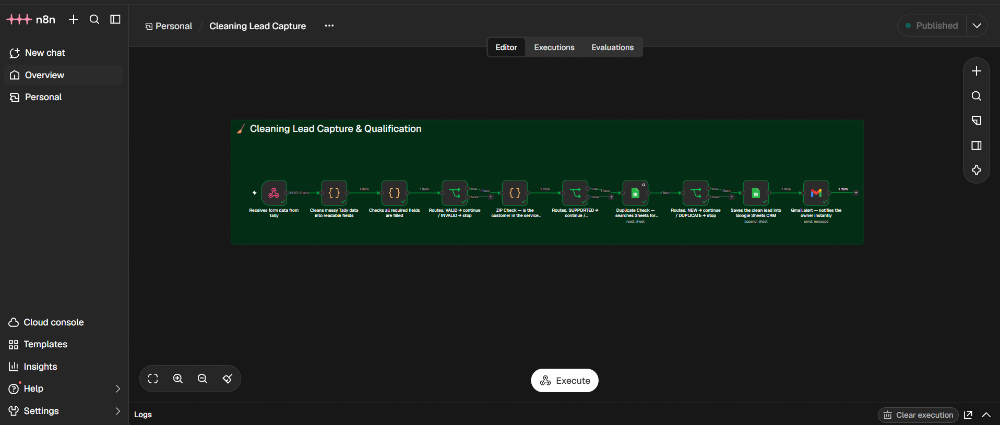

# 🧹 Cleaning Lead Capture & Qualification

An automated lead capture and qualification system built with n8n, designed for residential cleaning businesses. It receives enquiries from a Tally form, validates and qualifies each lead, stores clean data in a Google Sheets CRM, and sends instant Gmail notifications to the business owner — fully automated, zero manual work.

---

## 🚀 Demo

👉 [Watch Demo Video](https://drive.google.com/file/d/1Vq2Tq8Lf7BbdsptTT1e4Lzb3cP46Kstp/view?usp=drive_link)

---

## 🛠️ Tools & Technologies

| Tool | Purpose |
|------|---------|
| n8n | Workflow automation engine |
| Tally | Lead capture form (webhook trigger) |
| Google Sheets | CRM database for qualified leads |
| Gmail | Instant email notifications to owner |

---

## 📌 Project Overview

Residential cleaning businesses struggle with:

❌ Missing leads because they check emails manually  
❌ Wasting time on leads outside their service area  
❌ Duplicate client entries in their CRM  
❌ No instant alert system for new leads  
❌ Lost revenue from slow or disorganised follow-up  

This system solves all of that:

✅ Captures every lead automatically from a Tally form  
✅ Validates required fields and rejects incomplete submissions  
✅ Checks the customer's ZIP code against the service area  
✅ Detects and blocks duplicate leads from entering the CRM  
✅ Saves qualified leads to Google Sheets with clean data  
✅ Sends the owner an instant Gmail alert for every new lead  

---

## ⚡ How It Works

```
Tally Form Submission
        ↓
Data Formatter (clean field names)
        ↓
Field Validator (name, email, phone, ZIP, service type)
        ↓
   Valid? ──No──→ STOP
        ↓ Yes
ZIP Code Checker (service area validation)
        ↓
In Area? ──No──→ STOP
        ↓ Yes
Duplicate Checker (search Google Sheets)
        ↓
Duplicate? ──Yes──→ STOP
        ↓ No
Google Sheets CRM (append row)
        ↓
Gmail Alert (notify owner instantly)
```

---

## 📸 Workflow Screenshot



---

## 🧠 Workflow Nodes (10 Nodes)

| Node | Name | Description |
|------|------|-------------|
| 1 | Tally Webhook Trigger | Receives form submissions in real time |
| 2 | Data Formatter | Cleans Tally field names into readable keys |
| 3 | Field Validator | Checks all required fields are filled |
| 4 | Validation Router | VALID → continue / INVALID → stop |
| 5 | ZIP Code Checker | Validates customer is in service area |
| 6 | Service Area Router | SUPPORTED → continue / UNSUPPORTED → stop |
| 7 | Duplicate Checker | Searches Google Sheets for existing email/phone |
| 8 | Duplicate Router | NEW → continue / DUPLICATE → stop |
| 9 | Google Sheets Append | Saves qualified lead with all fields + timestamp |
| 10 | Gmail Alert | Sends owner instant email with full lead details |

---

## 📋 Google Sheets CRM Columns

- Name
- Email
- Phone
- ZIP Code
- Service Type
- Bedrooms / Bathrooms
- Frequency
- Preferred Date
- Special Instructions
- Service Area
- Status
- Submitted At
- Lead Source

---

## 💡 What I Learned

- Building multi-stage validation and routing workflows in n8n
- Parsing and cleaning Tally webhook payloads
- Using IF and Switch nodes for conditional routing logic
- Connecting n8n to Google Sheets for CRM operations
- Searching existing Sheet data to detect duplicates
- Sending structured Gmail notifications from n8n
- Designing production-ready lead qualification pipelines

---

## 🔗 Links

- 🎥 [Demo Video](https://drive.google.com/file/d/1Vq2Tq8Lf7BbdsptTT1e4Lzb3cP46Kstp/view?usp=drive_link)
- 📁 [Workflow JSON](https://drive.google.com/file/d/1SZUphNBQTAvIhpaHwSIfvs8UpCO0OUqF/view?usp=drive_link)

---

## 👤 About Me

**Omi Mojumdar** — AI Automation Freelancer

- 🔗 [LinkedIn](https://www.linkedin.com/in/omi-mojumdar-900923388)
- 📧 omimojumdar88@gmail.com
